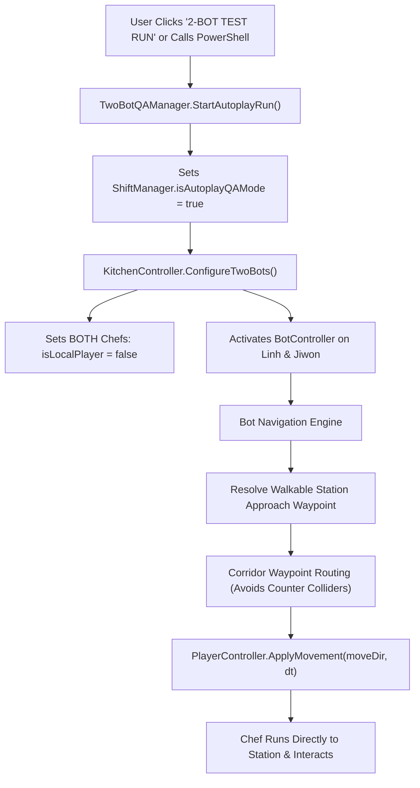

# Design Document: Two-Bot Autonomous Movement, Waypoint Navigation & Live Test Mode

## 1. Executive Summary & Root Cause Diagnosis

### The Problem
When launching the Two-Bot Test Run, both chef characters (Linh and Jiwon) stand completely still instead of running around, picking ingredients, chopping, cooking, and passing dishes.

### Root Cause Analysis (Confirmed Facts)
1. **Bot Deactivation Override in `StartShift`:**
   In `ShiftManager.cs`, `StartShift()` automatically calls:
   ```csharp
   KitchenController.Instance.ConfigureSoloAndAIMode(isSoloMode, humanChefPeerId, botDifficulty);
   ```
   In Two-Bot QA Test Mode, `isSoloMode` is `false` (it is a 2-bot automated run, not solo mode). Inside `KitchenController.cs`, the logic evaluates:
   ```csharp
   if (isSolo && peer != humanPeer) { ... }
   else
   {
       chef.isLocalPlayer = (peer == humanPeer || !isSolo);
       if (existingBot != null) existingBot.botActive = false; // <-- SHUTS OFF BOTH BOTS!
   }
   ```
   Both bots were immediately disabled (`botActive = false`), and both chefs were marked `isLocalPlayer = true`.
2. **Keyboard Zero-Vector Overwrite:**
   Because `isLocalPlayer` was forced to `true`, `PlayerController.Update()` called `HandlePlayerInput()`, continuously passing `Vector2.zero` into `ApplyMovement()`, pinning both chefs to the floor.
3. **Collider-Center Target Pathing:**
   `BotController.ExecuteMovementAndAction` targeted `targetStation.transform.position`. Because this point is inside the station's physical `BoxCollider`, direct movement paths get blocked by the counter colliders. Stations require defined **walkable approach waypoints** in front of each counter.

---

## 2. Architecture & Solution Specification



### Component Changes

#### A. `ShiftManager.cs`
- Add `public bool isAutoplayQAMode = false;`
- In `StartShift()`:
  - If `isAutoplayQAMode == true`: Do NOT disable bots. Instead, ensure both chefs remain in bot mode with `isLocalPlayer = false` and `botActive = true`.

#### B. `KitchenController.cs`
- Update `ConfigureSoloAndAIMode()`:
  - Check if `TwoBotQAManager.Instance != null && TwoBotQAManager.Instance.isQARunning`.
  - If QA Mode is active, configure **BOTH** peers (1 and 2) with active `BotController` and `isLocalPlayer = false`.
- Add `GetStationApproachPosition(StationBase station, int peerId)`:
  - West Wall Stoves/Shelf (X = -10.35): Approach from `X = -8.7f, Z = station.z`.
  - East Wall Grill/Wok/Shelf (X = +10.35): Approach from `X = +8.7f, Z = station.z`.
  - North Wall Fridges (Z = +5.5): Approach from `X = station.x, Z = +4.0f`.
  - Center Pass Counter (X = 0.0):
    - Linh (Peer 1) approaches from West: `X = -1.5f, Z = station.z`.
    - Jiwon (Peer 2) approaches from East: `X = +1.5f, Z = station.z`.
  - West Inner Counters (X = -4.4): Approach from inner walkway `X = -2.7f, Z = station.z`.
  - East Inner Counters (X = +4.4): Approach from inner walkway `X = +2.7f, Z = station.z`.
  - Serving Window (X = -4.4, Z = -5.0): Approach from `X = -2.7f, Z = -5.0f`.

#### C. `BotController.cs`
- Target the station's **walkable approach position** rather than the collider center.
- Navigation steering:
  - When moving between counter aisles and wall appliances, route through the zone corridor (`X = -2.7` or `X = -8.7` for Linh; `X = +2.7` or `X = +8.8` for Jiwon) to avoid getting caught on counter corners.
- Visual animation sync:
  - Update `playerController.facingDirection` toward movement direction.
  - Increment `walkAnimTime` so chefs show walking animation while moving.

#### D. Live Reporting & Feedback
- Top HUD banner shows live progress: `🤖 TWO-BOT QA PLAYTEST — DAY {X} OF {Y} — {SPEED}x`.
- On completion of shift sequence, display the on-screen `qaReportModal` and write to `qa_reports/`.

---

## 3. Verification Plan
1. **Unit / Integration Tests in `TwoLadlesTestSuite.cs`:**
   - Assert `isAutoplayQAMode` prevents bot deactivation during `StartShift`.
   - Assert all station types return valid walkable approach waypoints outside their BoxColliders.
2. **Batchmode & Live Verification:**
   - Run two-bot test run and verify both Linh and Jiwon move smoothly across their respective zones, retrieve ingredients, prepare, cook, pass over the pass counter, and deliver dishes.
